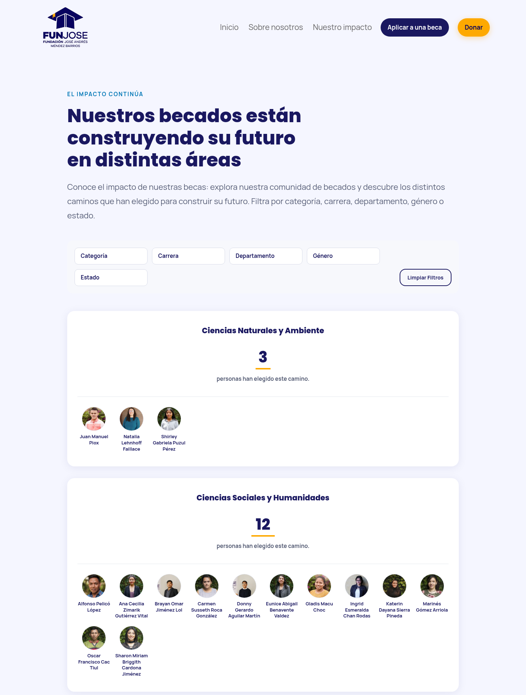
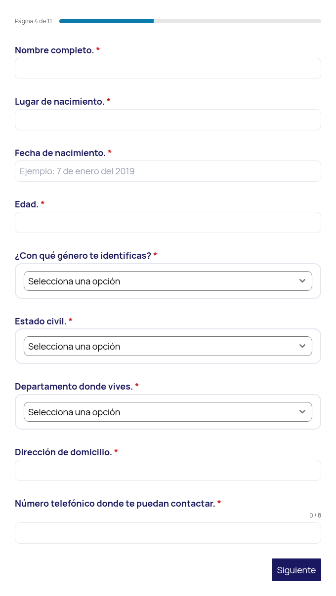

	<h3 class="mb-3 mt-2">{{page.title}}</h3>
	

		{{ category }}
	

	{{page.description}}

	

	

		
Available online

		
<a href="https://www.funjose.org.gt/" target="_blank">funjose.org.gt</a>

	

	

		
Available on github <i class="ti-github" style="vertical-align:middle;"></i>

		
Website code not public available

	

	

		
	

	

		
	

	

		
	

